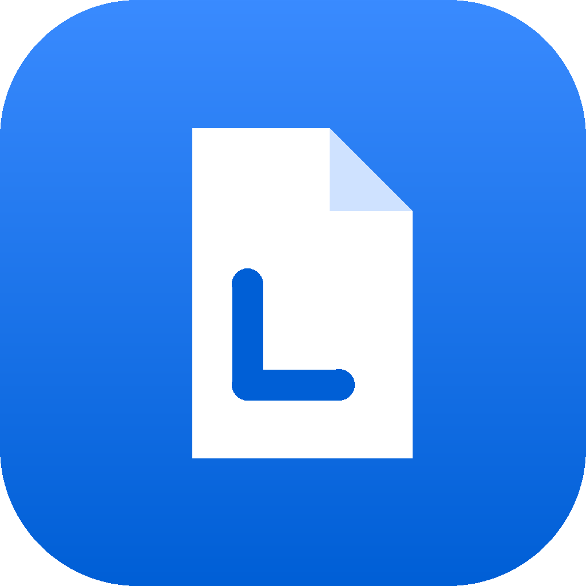

<h1 align="center">Loeito — PDF, just right</h1>

A free, private PDF workbench for everyday work: read, merge, edit, sign, fill and make forms, OCR scans, pull tables into Excel, and protect files with passwords.

<b><a href="../../releases/latest">Download</a></b> · <b><a href="https://datakeen.github.io/loeito/">Try it in your browser</a></b>

Your files never leave your computer. No account, no upload, no subscription. The installed app works without internet from the very first start.

**Version 1.9.0** · Windows, macOS and Linux · free and open source (GNU AGPL v3)

In the browser, everything works except folder browsing, opening Word / Excel / PowerPoint files and passwords; those need the desktop app.

## Download and install

1. Open the **[Releases](../../releases/latest)** page.
2. Download the file for your computer:
   - **Windows:** `Loeito-Setup-….exe`
   - **macOS:** `Loeito-…-arm64.dmg` for Apple chips (M1 and newer, 2020 onward), `Loeito-…-x64.dmg` for older Intel Macs
   - **Linux:** `Loeito-….AppImage`
3. Open the downloaded file and follow the steps. Then start **Loeito** like any other program.

Windows or macOS may warn that the app is from an unknown publisher, because it is not yet code-signed. On Windows click **More info → Run anyway**.

## What it does

| Tool | For |
|---|---|
| **Merge PDFs** | Put PDFs, pictures and Office files together in the order you want |
| **Read** | A calm reader with themes, focus mode, contents and read-aloud |
| **Pages** | Rotate, reorder, delete, extract and split pages |
| **Edit** | Add or fix text, highlight, white-out, draw, sign, add pictures |
| **Crop** | Trim margins on one, odd/even or all pages |
| **Searchable** | Make scans searchable and copyable (OCR) |
| **Tables** | Tables, even from scans, to Excel, CSV, Word or Markdown |
| **Digitize** | Graphs to numbers; maps to Shapefile, GeoJSON, KML, DXF and more |
| **Optimize** | Make files smaller; change the paper size |
| **Stamp** | Page numbers, Bates numbers, headers, footers, watermarks |
| **Covers** | Designed front covers and last pages for books, reports and theses |
| **Forms** | 10 templates, draw fields or find them automatically, dates with a calendar, totals, fill in |
| **Properties** | Title, author, keywords and other document details |
| **Protect** | Black out private details for real, remove hidden data, add passwords |

Handy everywhere: several documents in tabs, **Ctrl K** to find any command, **Ctrl S** to save, and **?** for all keyboard shortcuts.

## What "free" means here

Free software usually means two things. Here it means three.

1. Free as in bread: it takes nothing from your pocket.
2. Free to go: use it for any purpose, and share it with anyone.
3. Free from friction: your work flows the way you like to work. One task, many paths, from different tools, by mouse or by keyboard.

The third freedom is still growing. Each new version is one more step toward it, and that's a commitment.

## Help

Inside Loeito, click **Help (?)**: quick help, short tutorials, the User Manual and keyboard shortcuts. The same documents are here:

- **[Help](docs/Help.md)**: what each tool does, in short
- **[User Manual](docs/User%20Manual.md)**: how to use everything, step by step
- **[Tutorials](docs/tutorials/)**: 15 short hands-on lessons, one per tool
- **[Reference Manual](docs/Reference%20Manual.md)**: how Loeito works inside, for developers

Found a problem or have an idea? Open an **[Issue](../../issues)**. See [ROADMAP.md](ROADMAP.md) for what is coming and [CONTRIBUTING.md](CONTRIBUTING.md) to help, or to run Loeito from the source code.

## Support Loeito

Loeito is free and open-source software. If you enjoy working with it, it has done what it was made for, and you owe nothing in return. Still, every kind of help is welcome. See the [roadmap](ROADMAP.md); if you like where Loeito is going, you can:

1. **Share it:** tell others about Loeito, or show what you made with it.
2. **Support the projects it stands on:** [pdf.js](https://github.com/mozilla/pdf.js) · [pdf-lib](https://github.com/Hopding/pdf-lib) · [Tesseract.js](https://github.com/naptha/tesseract.js) · [Tesseract OCR](https://github.com/tesseract-ocr/tesseract) · [JSZip](https://github.com/Stuk/jszip) · [SheetJS](https://github.com/SheetJS/sheetjs) · [Inter](https://github.com/rsms/inter) · [Electron](https://github.com/electron/electron).
3. **Help build it:** code, translations or documents ([CONTRIBUTING.md](CONTRIBUTING.md)).
4. **Sponsor a feature:** something from the roadmap sooner, or something new.
5. **Become a sponsor:** organizations can support Loeito as a Gold, Silver or Bronze sponsor and be thanked here.

**Get in touch:** [send me a message](https://tally.so/r/7XbpbP). It's a short form for individuals and organizations alike.

## License

Copyright (C) 2026 Ahmed Bilal and contributors. Loeito is free software under the GNU Affero General Public License, version 3 or later. It comes with **no warranty**. See [LICENSE](LICENSE), and [NOTICE.md](NOTICE.md) for the open-source components Loeito is built on.

Made by Ahmed Bilal · [LinkedIn](https://www.linkedin.com/in/abilal)
